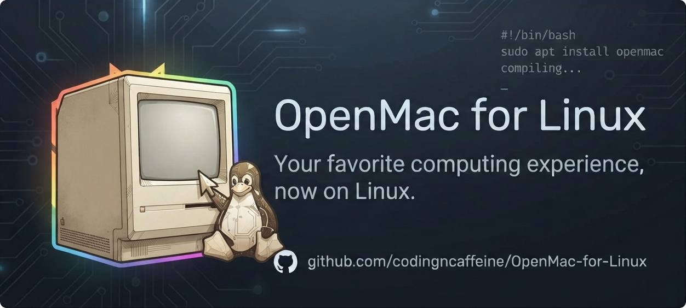

<p align="center"></p>

# OpenMac for Linux

A from-scratch Macintosh emulator for Linux: three machines over one shared
core, implemented from period hardware documentation. This is the Linux port of
[OpenMac](https://github.com/codingncaffeine/OpenMac) — the same C++ core and
the same front end, with the Windows plumbing swapped for Linux equivalents
(WPF → Avalonia, waveOut → SDL3).

> **Status:** alpha. All three machines boot and run in the Linux front end,
> with sound, captured mouse and keyboard, floppies, hard disks and the drop
> box. CD images and networking are in but have not been tested on Linux yet.
> Expect rough edges, and please report what you find.

- **Macintosh Classic** — 68000 (validated against the SingleStepTests suite at
  100% state accuracy), VIA 6522, ADB, IWM floppy, NCR 5380 SCSI, real-time
  clock, and the scanline sound buffer. Boots System 6.0.8 and System 7.0.1 to a
  fully working desktop, and the ROM's built-in System 6.0.3 ROM disk.
- **Macintosh IIfx** — 40 MHz 68030/68882, OSS interrupt controller, dual I/O
  Processor interfaces, NCR 5380 SCSI, internal SuperDrive, ASC audio, and the
  **Macintosh Display Card 8•24 GC** in slot $9: the card's Am29000 runs Apple's
  own GC QuickDraw, so the desktop is drawn by the accelerator, in 1-bit through
  24-bit color. Boots the supplied 512 KB IIfx ROM and compatible System 6/7
  media to Finder from either floppy or SCSI, with every legal 4–128 MB physical
  RAM layout and period 80/160 MB hard disks.
- **Quadra 650** — 68040 with its FPU and MMU, DAFB video, 53C96 SCSI, SWIM2
  floppy, Z8530 SCC, the Apple Sound Chip, and VIA1/VIA2. Boots System 7.5 and
  7.5.3 from a hard disk to the Finder desktop, with 8 to 136 MB of RAM and six
  display sizes from 512×384 to 1152×870.

**The [wiki](https://github.com/codingncaffeine/OpenMac/wiki) has the full story**
— the architecture, per-chip hardware notes, and how each subsystem was brought up.

## Install

Downloads are on the [releases page](https://github.com/codingncaffeine/OpenMac-for-Linux/releases).
Everything the app needs is inside, including the .NET runtime and SDL3 for sound.

- **Debian and Ubuntu** — `sudo apt install ./openmac_<version>_amd64.deb`, then
  start OpenMac from the application menu or run `openmac`.
- **Any other glibc distro (Arch, Fedora, …)** — extract
  `OpenMac-<version>-linux-x64.tar.gz` anywhere and run `./OpenMac`.
- **Alpine and other musl systems** — extract
  `OpenMac-<version>-linux-musl-x64.tar.gz` and run `./OpenMac`; it needs
  `apk add icu-libs libstdc++ libgcc fontconfig libx11 libice libsm libxi libxfixes libxcursor libxrandr libxext`.

The app is an X11 client and runs through XWayland on Wayland sessions.
Settings, parameter RAM and the log live in `~/.config/OpenMac/`.

## Getting started

1. Install (above) or build (below).
2. Machine ▸ Model to choose the Classic, Macintosh IIfx, or Quadra 650.
3. File ▸ Open ROM… and choose the matching ROM dump.
4. Insert a floppy image, or create a hard disk and install a System onto it, and boot.

For the IIfx, use the 512 KB ROM with checksum `4147DD77`. The RAM menu exposes
only realizable four-SIMM bank totals: 4, 8, 16, 20, 32, 64, 68, 80, and
128 MB. File ▸ Create Hard Disk includes the typical 80 MB and 160 MB choices;
raw, DiskCopy 4.2, and MacBinary-wrapped 400K/800K/1.44 MB floppy images work in
the internal SuperDrive.

Without a card ROM the IIfx uses OpenMac's own plain video card. For the
Display Card 8•24 GC, choose its declaration ROM (part number 341-0266) with
Machine ▸ 8•24 GC Card ROM…. Acceleration also needs the card's own `8•24 GC` control
panel in the Control Panels folder of the Mac's startup disk, under its
original name: drag it onto the System Folder, let the Finder put it away, and
restart. The rocket climbing the left edge of the screen during startup is the
card's software coming up.

Click the Mac's screen to give it the mouse and keyboard; while it has them,
desktop shortcuts such as Super and Alt+Tab go to the Mac. Middle-click gives
them back.

## What it does

- **Floppies** — 400K, 800K and 1.44 MB images, DiskCopy 4.2 and MacBinary
  containers unwrapped on the way in and rebuilt on the way out; what the Mac
  writes goes back to the file it came from
- **Hard disks** — create a blank HFS volume in the app, install a System onto
  it, and boot from it; volumes are settled however the session ends, so a disk
  stays bootable
- **CD-ROM** — attach a disc image and it mounts on the desktop
- **Drop box** — a folder on your computer, kept mounted inside the Mac as a
  volume; files dropped on the window land in it
- **Parameter RAM persists**, so the startup disk, sound volume, 32-bit
  addressing and the date survive quitting
- **Help ▸ Capture Diagnostics** writes a snapshot of what the machine is doing

## ROMs and software

OpenMac contains no Apple code. You supply your own Macintosh ROM dump and Apple
system software, dumped from media and hardware you own. Nothing of the sort is
included in — or may be contributed to — this repository.

## Building

The core is dependency-free C++20; the front end is a .NET 10 Avalonia app.
You need CMake 3.25+, a C++20 compiler, the .NET 10 SDK, and SDL3 (for audio).

```
tools/build.sh        # core + tests + app; the runnable build lands in bin/
bin/openmac
```

or step by step:

```
cmake -B build -DCMAKE_BUILD_TYPE=Release
cmake --build build --parallel
dotnet build gui -c Release
```

The build is checked on glibc and on musl (`tools/alpine-build.sh` builds it in
an Alpine container with Alpine's own compiler and .NET SDK).
`packaging/build-release.sh` makes the release archives and the `.deb`;
`packaging/smoke-test.sh` and `packaging/install-test.sh` launch them here and
in clean Debian, Ubuntu, Fedora and Alpine containers.

MIT licensed. Clean-room: primary sources are the chip datasheets and Apple's
published hardware documentation; other emulators were consulted only as
behavioral references, never copied — with the one exception credited below.

## Credits

- **Philip Bennett** — the Am29000 CPU core that drives the 8•24 GC's
  processor is adapted from his portable Am29000 core in MAME (BSD-3-Clause;
  see `THIRD-PARTY-NOTICES.md`). Having a working instruction set, pipeline
  model and dispatch tables to start from is what made bringing up Apple's GC
  QuickDraw software on the card possible. OpenMac's copy adds the Dolphin
  memory callbacks and the corrections documented in the wiki (data-width
  load/store semantics, channel-register restart of trapped accesses, timer
  and interrupt-return behavior).
- **AMD** — the Am29000 and Am29030 user's manuals, preserved by Bitsavers,
  settled every question about what the processor really does.
- **SingleStepTests** — the 680x0 conformance suite the 68000 core is
  validated against.
- doctest, nlohmann/json and miniz (tests), SDL3 and Dear ImGui (the optional
  developer shell) — fetched at build time under their own licenses.
